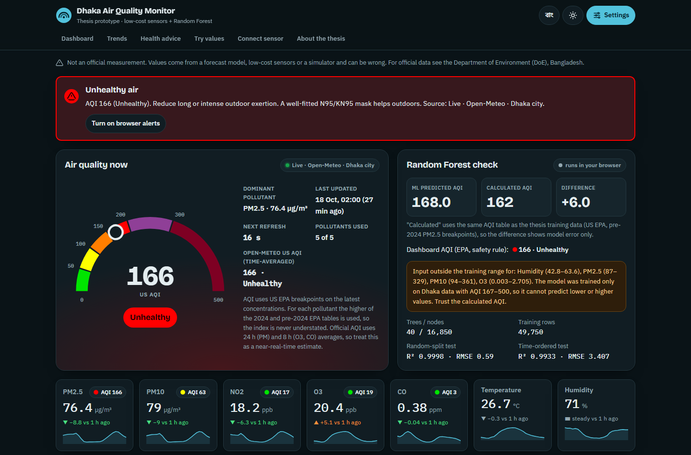
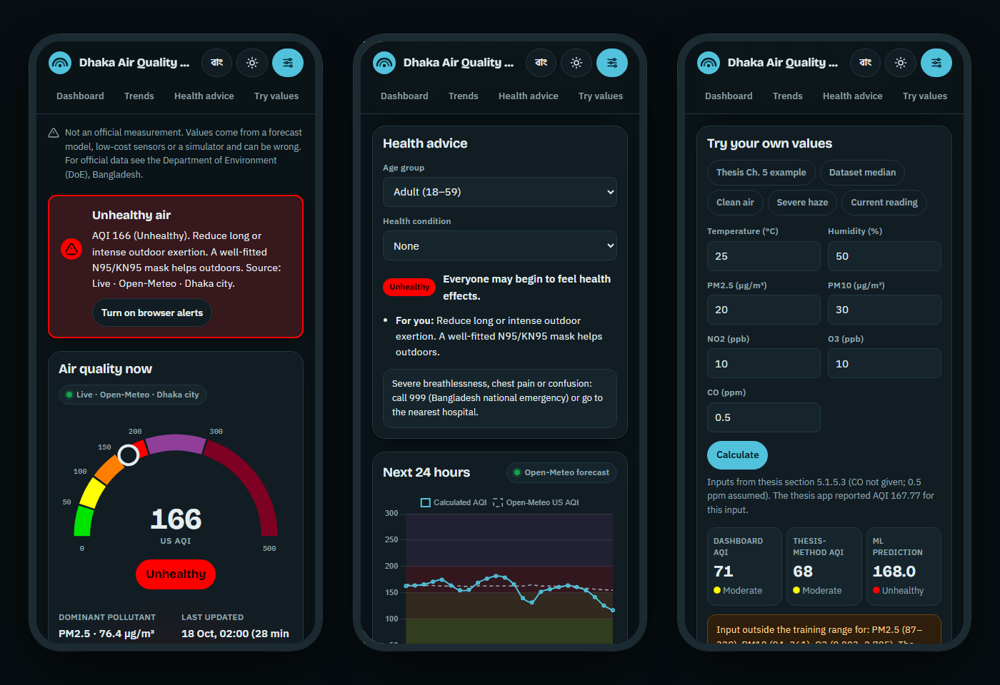
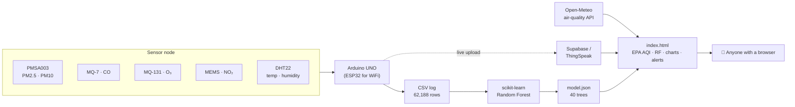
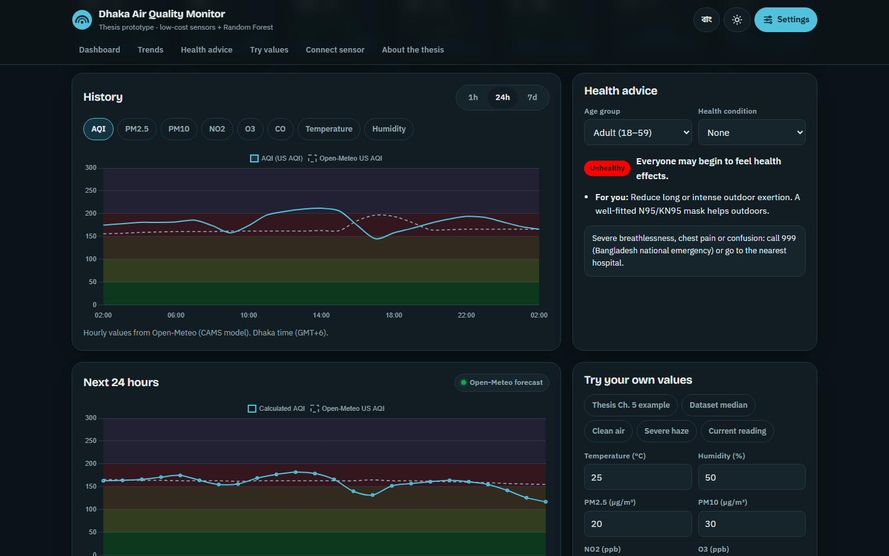

<a href="https://airqualitypredictionapp.netlify.app/">
  
</a>

<p align="center">
  <a href="https://airqualitypredictionapp.netlify.app/"></a>
</p>

<p align="center">
  
  
  
  
  
  
  
  
</p>

<p align="center">
  <b>
  <a href="https://airqualitypredictionapp.netlify.app/">Open the app</a> ·
  <a href="#-how-it-works">How it works</a> ·
  <a href="#-the-model">The model</a> ·
  <a href="#-connect-your-own-sensor">Connect a sensor</a> ·
  <a href="#-run-it-yourself">Run it yourself</a>
  </b>
</p>

---

Dhaka is one of the most polluted cities on Earth, and official monitoring stations are few and far between. This project is our **CSE400C capstone at East West University**. We built a low-cost IoT sensor node, collected **62,188 readings** in Badda and Aftabnagar, trained a **Random Forest** to predict the US EPA Air Quality Index, and shipped it as a **real-time web dashboard** that anyone can open on a phone.

The whole app is **one HTML file**. The trained forest is exported to JSON and runs in the browser, with no server, no build step and no API key.

<picture>
  <source media="(prefers-color-scheme: dark)" srcset="docs/screenshots/dashboard-dark.png">
  <source media="(prefers-color-scheme: light)" srcset="docs/screenshots/dashboard-light.png">
  
</picture>

## ✨ Highlights

| | |
|---|---|
| 🌫️ **Live AQI for Dhaka** | Animated AQI gauge, category, dominant pollutant and 7 metric cards with trend arrows and sparklines. Refreshes every 30 seconds. |
| 🧮 **US EPA AQI engine** | Sub-indices for PM2.5, PM10, NO₂, O₃ and CO; overall AQI = the highest. Unit conversion from µg/m³ to ppb/ppm. Never understates: for each pollutant it uses the higher of the 2024 and pre-2024 EPA tables. |
| 🌲 **Random Forest in the browser** | 40 trees, 16,850 nodes, 300 KB of JSON. Shows "ML predicted AQI" next to the formula AQI and the difference, and warns when inputs are outside what the model was trained on. |
| 🔌 **Three data modes** | Live Dhaka (Open-Meteo), My Sensors (Supabase, ThingSpeak or any JSON URL) and a Demo simulator for presentations. Falls back to the demo with a visible notice if live data fails. |
| 📈 **History and forecast** | 1 h / 24 h / 7 d charts for AQI and every pollutant, AQI category bands, and a 24-hour forecast. |
| 🩺 **Personal health advice** | Advice per AQI category for children, adults and 60+, with asthma and heart-disease guidance. Alert banner and optional browser notification at Unhealthy or worse. |
| 🌐 **Made for Bangladesh** | English / বাংলা toggle, light and dark mode, mobile-first layout, keyboard and screen-reader friendly. |

<p align="center">
  
</p>

## 🧭 How it works



1. **Sense.** The node reads particulate matter, three gases, temperature and humidity.
2. **Label.** Each row gets a US EPA AQI: one sub-index per pollutant, overall AQI = the maximum.
3. **Learn.** A Random Forest learns AQI from the 7 raw readings.
4. **Ship.** The forest is exported to compact JSON and embedded in the page, so prediction happens on the user's device.

## 🧠 The model

**Data.** 62,188 rows logged on 3–4 December 2025 in Badda and Aftabnagar, Dhaka. Features, in order: `Temp, Humidity, PM2.5, PM10, NO2, O3, CO`. Target: `AQI` (US EPA). No missing values.

**Model.** `RandomForestRegressor(n_estimators=40, max_depth=10, min_samples_leaf=5, random_state=42)`.

| Evaluation | R² | RMSE | MAE | Test rows |
|---|---:|---:|---:|---:|
| **Time-ordered hold-out** (train on the first 80% by time, test on the last 20%) | **0.9933** | **3.41** | **1.87** | 12,438 |
| Random 80/20 split | 0.9998 | 0.59 | 0.008 | 12,438 |
| LightGBM (default params), time-ordered | 0.9945 | 3.10 | 2.18 | 12,438 |

We report the **time-ordered** score as the headline. The sensor logs about 119 rows per minute, so a random split puts near-identical rows on both sides and inflates the score.

**What drives the prediction** (impurity importance): PM2.5 **0.968** · PM10 0.018 · O₃ 0.009 · CO 0.006 · temperature, humidity, NO₂ ≈ 0. This matches Dhaka's reality: fine particles dominate the AQI.

**From Python to the browser.** `model/train.py` exports the forest as `{"features":[...],"trees":[{"f":[],"t":[],"l":[],"r":[],"v":[]}]}`, which is 307 KB. The same tree walk was re-implemented in Python and in the page's JavaScript, then checked against scikit-learn:

| Check | Rows | Max abs. difference |
|---|---:|---:|
| Python re-implementation vs scikit-learn | 12,438 | 0.00092 |
| JavaScript in `index.html` vs scikit-learn | 300 | 0.00019 |

<p align="center">
  
</p>

## 🧪 AQI engine, tested

The AQI code was run on 17 test cases, including the worked examples in the US EPA technical guidance. All 17 pass.

| Input | Expected | App |
|---|---:|---:|
| PM2.5 = 35.9 µg/m³ (EPA example) | 102 | 102 ✅ |
| O₃ = 0.07853 ppm (EPA example) | 126 | 126 ✅ |
| CO = 8.4 ppm (EPA example) | 90 | 90 ✅ |
| PM2.5 = 9.0 / 9.1 µg/m³ (2024 Good/Moderate edge) | 50 / 51 | 50 / 51 ✅ |
| O₃ = 210 ppb (1-hour table) | 203 | 203 ✅ |
| PM2.5 = 400 µg/m³ | 500+ | 500+ ✅ |

On 20,000 random inputs, the dashboard AQI was **never lower** than either EPA table. Gas conversions at 25 °C: 1 ppb NO₂ = 1.88 µg/m³, 1 ppb O₃ = 1.96 µg/m³, 1 ppm CO = 1.15 mg/m³.

## 🔌 Three data modes

| Mode | Source | Use it for |
|---|---|---|
| **Live Dhaka** *(default)* | [Open-Meteo Air Quality API](https://open-meteo.com/en/docs/air-quality-api) (CAMS model, hourly, no key). Presets: Dhaka city, Badda, Aftabnagar. | Real-time city-level monitoring and the 24 h forecast |
| **My Sensors** | Your own node through Supabase REST, a ThingSpeak channel or any JSON URL | Showing your own hardware's live readings |
| **Demo simulator** | Deterministic Dhaka-like values with daily cycles. Three scenarios: typical day, winter haze, after rain | Presenting without internet or hardware. Clearly labelled as simulated |

Switch modes in **Settings**. The choice is remembered in the browser.

## 🛰️ Connect your own sensor

The Arduino UNO used for data collection has no WiFi. For live upload use an **ESP32** (or ESP8266).

1. Create a free [Supabase](https://supabase.com) project and run the SQL from the app's **Connect sensor** section. It creates a `readings` table with row-level security.
2. Flash the ESP32 sketch from the same section: PMSA003 over UART, DHT22, MQ-7 / MQ-131 / MEMS NO₂ on ADC1 pins, one JSON reading every 30 seconds.
3. In the app open **Settings → My sensors** and paste the project URL and the **anon** key (never the `service_role` key).

```json
{ "created_at": "2026-10-18T10:15:00Z", "site": "badda",
  "pm25": 85.0, "pm10": 132.0, "no2_ppb": 22.4, "o3_ppb": 18.0,
  "co_ppm": 0.8, "temp_c": 29.1, "humidity": 64.0 }
```

> [!NOTE]
> The gas-sensor conversion functions in the sketch are placeholders. Calibrate MQ-7, MQ-131 and the NO₂ module against a reference instrument before trusting their numbers.

## 🚀 Run it yourself

**Open it.** The app is a single file. Serve it locally:

```bash
git clone https://github.com/Majortarif/Air-Quality-Prediction-using-Machine-Learning-and-AI.git
cd Air-Quality-Prediction-using-Machine-Learning-and-AI
python -m http.server 8000
# open http://localhost:8000
```

**Deploy it.** Drag the folder (or a zip with `index.html` at the root) onto [app.netlify.com/drop](https://app.netlify.com/drop). It also works on GitHub Pages, Cloudflare Pages or Vercel.

**Retrain it.** The raw dataset is not part of this repository. With the CSV:

```bash
pip install -r requirements.txt
python model/train.py path/to/AQI_Ready_For_Streamlit.csv model      # metrics.json + model.json
python model/build.py path/to/AQI_Ready_For_Streamlit.csv model .    # rebuilds index.html
```

## 📁 Project structure

```text
.
├── index.html            # the whole app: UI, AQI engine, embedded Random Forest
├── model/
│   ├── train.py          # train + evaluate + export the forest to JSON + verify
│   ├── build.py          # embeds model.json and metrics into the page
│   ├── app.src.html      # page source before the model is embedded
│   ├── model.json        # exported Random Forest (40 trees)
│   └── metrics.json      # model metrics from the training run
├── docs/
│   ├── banner.svg
│   └── screenshots/
└── requirements.txt
```

## ⚠️ Limitations

- **Not an official measurement.** Live mode shows Open-Meteo's model estimates, not readings from our sensors. For official data see the Department of Environment, Bangladesh.
- **Short collection window.** The dataset covers about 8.7 hours over two mornings, and every reading falls in the Unhealthy to Hazardous range (AQI 167–500). The model cannot predict cleaner air: outside that range, trust the formula AQI. The app shows a warning when this happens.
- **New days need more data.** Trained on 3 December alone and tested on 4 December, R² drops to 0.53, because 4 December had PM2.5 levels the forest never saw.
- **The target is a formula.** AQI is computed from the same inputs, so the model learns the EPA lookup. The next step is true forecasting: predicting the next hours' AQI from past readings and weather.
- **Low-cost gas sensors drift.** MQ-series sensors need calibration. PM2.5 from the PMSA003 drives almost all of the AQI.

## 👥 Team

**CSE400C Capstone Project, Department of Computer Science and Engineering, East West University, Dhaka**

| | |
|---|---|
| **Supervisor** | Dr. Tania Sultana, Assistant Professor |
| **Team** | MD. Arshad Faysal · Monisha Bani Nibedita Shuci · Tariful Hoque |

Live data: [Open-Meteo](https://open-meteo.com/) (CAMS, CC BY 4.0). Charts: [Chart.js](https://www.chartjs.org/).

## 📬 Author

**Tariful Hoque** · CSE graduate, East West University · Machine Learning · Data Science · UI/UX

[GitHub](https://github.com/Majortarif) · [LinkedIn](https://www.linkedin.com/in/tariful-hoque-582321259) · [Portfolio](https://tarifulhoqueportfoloi.netlify.app/) · tarifulhoque347@gmail.com

<sub>Academic project. The AQI shown is an estimate for awareness and research, not medical or official advice.</sub>
